# Kargo-Based Environment Deployments for Konflux Common Infrastructure

> **Warning**
> Environment deployments are still under active development. This documentation may change as the implementation evolves.

Environment-based promotion pipeline for [infra-common-deployments](https://github.com/redhat-appstudio/infra-common-deployments) using [Kargo](https://kargo.io). This is the infra-common-deployments counterpart of the [ring-based architecture](https://github.com/redhat-appstudio/infra-deployments/blob/main/docs/ring-deployments/architecture.md) used in infra-deployments.

## Table of Contents

1. [Objective](#1-objective)
2. [Motivation](#2-motivation)
3. [Proposed Architecture](#3-proposed-architecture)
   - 3.1 [Kargo Project and Pipeline Structure](#31-kargo-project-and-pipeline-structure)
   - 3.2 [Environment Segmentation Strategy](#32-environment-segmentation-strategy)
   - 3.3 [CI and Artifact Ingestion](#33-ci-and-artifact-ingestion)
   - 3.4 [Staging Environment (Automated Inner Loop)](#34-staging-environment-automated-inner-loop)
   - 3.5 [Production Environment (Gated Promotion)](#35-production-environment-gated-promotion)
   - 3.6 [Verification Strategy](#36-verification-strategy)
   - 3.7 [Rollback and Reliability](#37-rollback-and-reliability)
   - 3.8 [Observability and Auditability](#38-observability-and-auditability)
4. [Component Interaction Model](#4-component-interaction-model)
5. [Freight Lifecycle](#5-freight-lifecycle)
6. [Failure Mode Analysis](#6-failure-mode-analysis)
7. [Definitions](#7-definitions)

---

## 1. Objective

Implement an automated, environment-based deployment pipeline for the shared infrastructure components in infra-common-deployments using [Kargo](https://kargo.io) to improve deployment safety, reduce manual effort, and ensure continuous availability. The pipeline leverages Kargo's native promotion engine—Warehouses, Freight, Stages, and Promotions—to model progressive delivery as a first-class GitOps workflow.

---

## 2. Motivation

Without environment-based delivery, changes to shared infrastructure components are promoted to all common clusters simultaneously after merging (each cluster's ArgoCD follows `main` with automated sync). That model is:

- **Time-consuming**: Each promotion requires human coordination across clusters.
- **Error-prone**: Manual steps introduce configuration drift and inconsistency.
- **High-risk**: A broken deployment affects all clusters simultaneously.

An environment-based model isolates blast radius, preserves platform availability, and automates the promotion lifecycle while retaining human oversight at the staging → production boundary.

---

## 3. Proposed Architecture

### 3.1 Kargo Project and Pipeline Structure

Each Konflux infrastructure repository is modeled as a **Kargo Project**—the unit of tenancy that scopes all pipeline resources (Warehouses, Stages, Promotions, Freight) to a single Kubernetes namespace. All Kargo Projects map to the two existing infrastructure repos:

- **[infra-deployments](https://github.com/redhat-appstudio/infra-deployments)** — Application-level component deployments (Konflux services, operators, controllers). Uses rings.
- **[infra-common-deployments](https://github.com/redhat-appstudio/infra-common-deployments)** — Shared infrastructure and platform-level resources (cluster config, RBAC, networking, observability). Uses environments.

This separation provides:

- **Isolation**: RBAC boundaries per infrastructure repository pipeline.
- **Independent Cadence**: Application components and shared infrastructure advance at their own pace without blocking each other.
- **Auditability**: All promotion activity is scoped and queryable per project.

Both repositories follow a **canonical directory layout** that ensures every component is structured identically across all environments. Kargo PromotionTasks write to a computable path per environment: the Tier 2 environment directory (`components/{component}/{environment}/`, where `environment` is `internal-staging`, `external-staging`, `internal-production`, or `external-production`). ArgoCD points at that same directory. For the full directory standard, tier definitions, and Kustomize layering rules, see the [Canonical Directory Layout](directory-layout.md) specification.

An **environment** is one of the four deployment targets above, and each maps to exactly one common cluster. Within each Project, the topology is modeled as a directed acyclic graph (DAG) of **Stages** — one for staging and one for production. A single Promotion writes every environment directory of its stage: the `staging` Stage updates `components/{component}/internal-staging/` and, for components that deploy externally, `components/{component}/external-staging/` in the same run; the `production` Stage does the same for `internal-production/` and `external-production/`. Environments inside a Stage are never promoted one at a time.

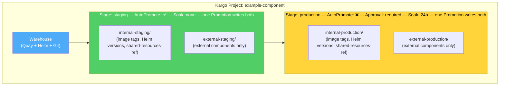

### 3.2 Environment Segmentation Strategy

Environments are defined by a risk-based grouping strategy. Each environment maps to one common cluster and is written by the Stage that owns it:

| Environment | Cluster | Criteria | Gate | Soak |
|-------------|---------|----------|------|------|
| **internal-staging** | `kflux-c-stg-i01` | Pre-production validation, broader integration testing, Argo CD sync/health validation | Fully automated | None |
| **external-staging** | `kflux-c-stg-e01` | Same as internal-staging, for external-facing components | Fully automated | None |
| **internal-production** | `kflux-c-prd-i01` | Shared platform workloads consumed by internal tenants | Manual approval + soak period | 24h |
| **external-production** | `kflux-c-prd-e01` | Same as internal-production, for external-facing tenants | Manual approval + soak period | 24h |

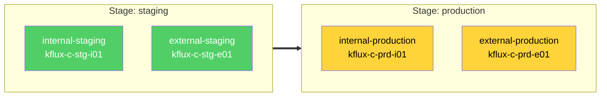

Both environment directories inside a Stage always move together — one Promotion writes both. There is no promotion edge between `internal-staging` and `external-staging`, and none between `internal-production` and `external-production`. Components that are not deployed externally simply omit the external environment directories: an internal-only component has `internal-staging/` and `internal-production/` and nothing else.

### 3.3 CI and Artifact Ingestion

The pipeline begins with artifact creation and discovery:

**Code Merge & Build**: Merging a component change triggers a build pipeline, producing versioned container images, Helm charts, and/or Git manifest commits.

**Kargo Warehouse**: A Warehouse is configured per artifact source (OCI registry, Helm repository, or Git repository). Each Warehouse defines **subscriptions** that specify:

- The artifact source URL (e.g., Quay registry, Helm repo, Git repo)
- The discovery strategy: **SemVer** (semantic version ordering), **Lexical** (string-based), **Digest** (content-addressable), or **NewestBuild** (timestamp-based)
- Optional filtering (e.g., SemVer constraints, path filters, allow/ignore lists)
- The polling interval (default: 5 minutes)

**Freight Creation**: When a Warehouse detects new artifact versions matching its subscriptions, it generates a new **Freight**—an immutable, content-addressed bundle that captures the exact combination of:

- Container image references (registry + tag + digest)
- Helm chart references (repository + name + version)
- Git commit references (repository URL + branch + commit SHA)

Freight is identified by a SHA-1 hash of its origin Warehouse and artifact versions, ensuring that identical inputs always produce the same Freight ID. This guarantees reproducibility and makes promotion decisions deterministic.

The Warehouse's `FreightCreationPolicy` controls whether Freight is created automatically upon discovery or requires an explicit manual trigger.

A Git-subscription Warehouse can also detect changes in the component's `shared-resources/` directory. On promotion to an environment, Kargo deletes the environment's old `shared-resources-ref/` directory in the component's environment folder and copies the component's `shared-resources/` directory from the repo at the SHA commit indicated in the freight, writing the new `shared-resources-ref/` within the same Promotion and avoiding an all-environments-at-once merge path. See [Canonical Directory Layout — Tier 1](directory-layout.md#41-tier-1--shared-resources) for details.

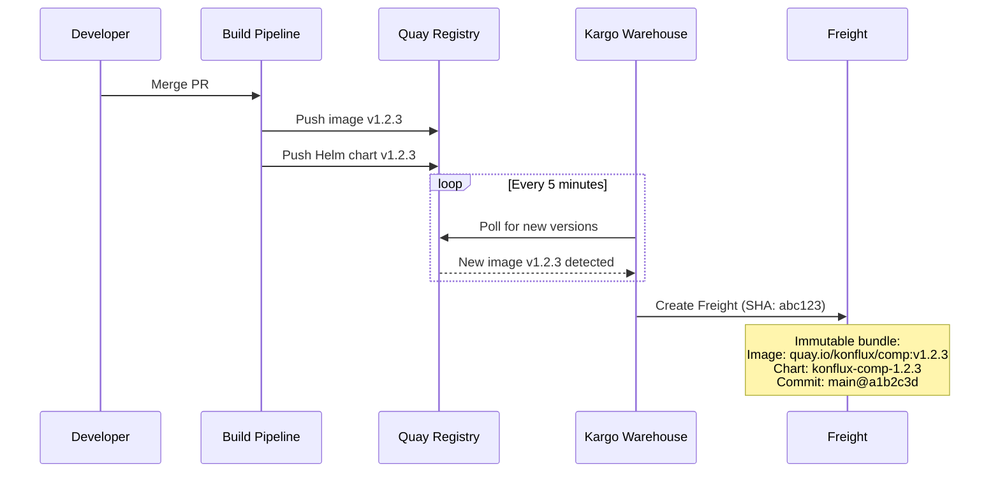

### 3.4 Staging Environment (Automated Inner Loop)

The staging Stage targets both staging environments (`internal-staging` and, for external components, `external-staging`) with **auto-promotion enabled**. A single Promotion updates `components/{component}/internal-staging/` and `components/{component}/external-staging/`, which ArgoCD reads for `kflux-c-stg-i01` and `kflux-c-stg-e01` respectively. When new Freight appears from the Warehouse, the pipeline proceeds automatically:

1. **Auto-Promotion**: The Stage's promotion policy (`autoPromotionEnabled: true`) triggers a Promotion immediately when new Freight is available. The selection strategy (`NewestFreight`) ensures the latest verified Freight is promoted.

2. **Promotion Execution**: Kargo creates a **Promotion** resource and executes its ordered **promotion steps**. For GitOps-based deployments, a typical step sequence is:
   - `git-clone` — Clone the environment's configuration repository
   - `yaml-update` / `kustomize-set-image` / `helm-template` — Update manifests to reference the new Freight's artifact versions
   - `git-commit` + `git-push` — Commit and push the changes
   - `git-open-pr` — Open a Pull Request against the target branch
   - `git-merge-pr` — Merge the PR

3. **Verification**: After the Promotion succeeds, the Stage runs **Verification** using Argo Rollouts AnalysisRuns. These can execute:
   - Smoke tests and integration tests
   - Health endpoint checks
   - Custom metric queries (Prometheus, Datadog, etc.)
   - Webhook-based external test triggers

4. **Freight Marked as Verified**: Upon successful verification, the Freight's status is updated to record `VerifiedIn: staging`, making it eligible for promotion to the production Stage.

Promotions within a Stage are **serialized**—only one Promotion runs at a time per Stage, with subsequent Promotions queued by creation time. This prevents deployment collisions and ensures each release completes its full verification cycle before the next begins.

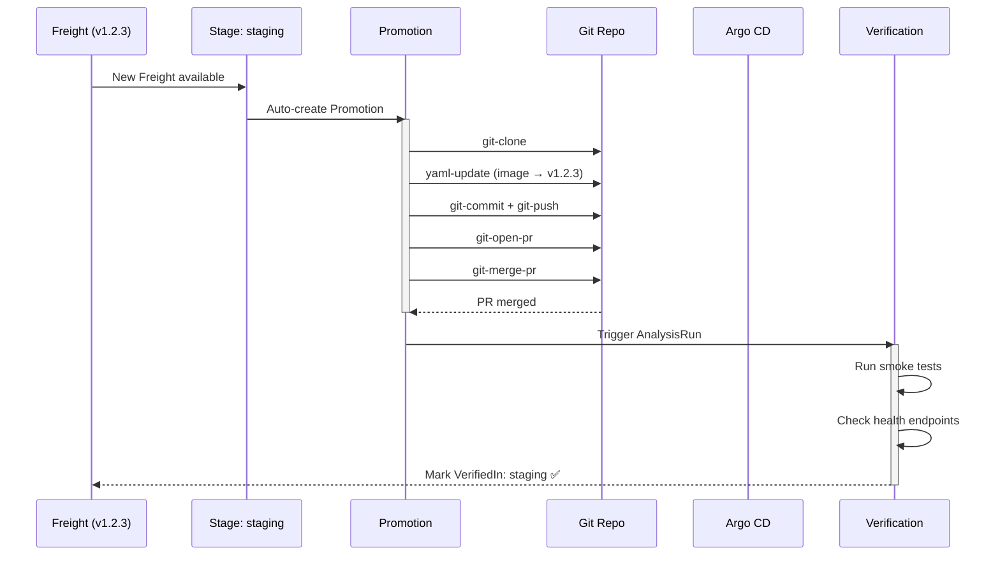

### 3.5 Production Environment (Gated Promotion)

The production Stage spans both production environments (`internal-production` and, for external components, `external-production`) and is promoted as one unit. It introduces two additional gates:

**Manual Approval**: Freight must be explicitly approved before it can be promoted to a production environment. Approval is recorded at the Freight level (`Freight.Status.ApprovedFor[stage-name]`) and can be granted by authorized users through the Kargo UI, CLI, or API. Approval can also bypass upstream verification requirements when emergency hotfixes are needed.

**Soak Period**: Each Stage defines a `RequiredSoakTime`; the production Stage enforces `24h`. Freight must remain stable in the current environment for the specified duration before becoming eligible for the next environment. The soak timer starts when the Freight is first deployed to the Stage (`CurrentlyIn` timestamp) and is tracked continuously. This ensures:

- Long-tail issues (memory leaks, gradual degradation, intermittent failures) surface before wider rollout.
- The system observes real-world load patterns across business cycles (daily peaks, batch jobs, etc.).
- Confidence in the release increases proportionally with exposure time.

The combination of manual approval and soak periods creates a layered defense: automated systems validate functional correctness, while human judgment and time-based observation validate operational stability.

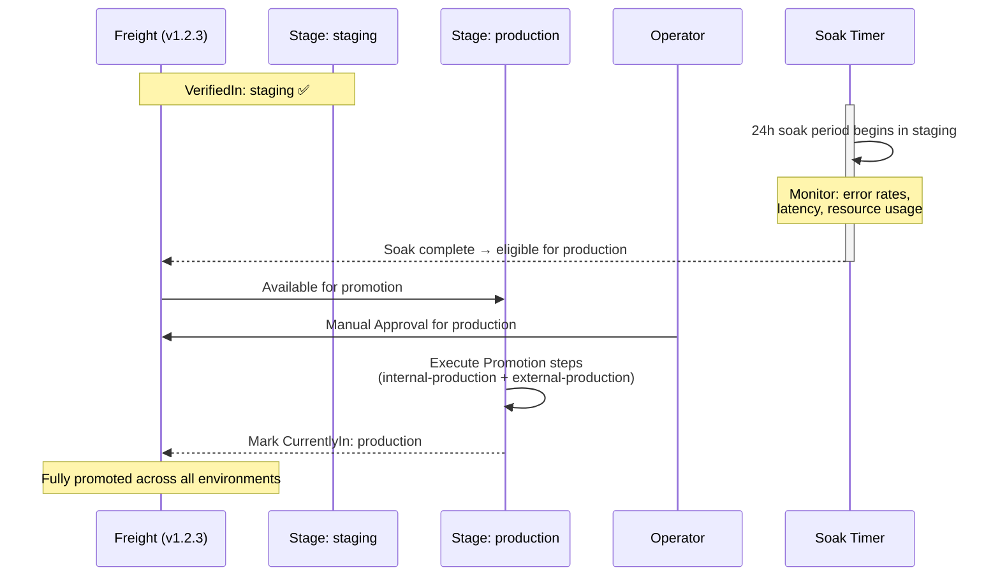

### 3.6 Verification Strategy

Verification is a first-class concept in Kargo, executed after each successful Promotion via Argo Rollouts AnalysisRuns. The verification strategy should be tiered by environment:

| Environment | Verification Scope | Examples | Duration |
|-------------|-------------------|----------|----------|
| staging | Functional correctness and integration stability | Component health checks, ArgoCD sync status, chainsaw-style policy tests, cross-component integration tests | ~30 min |
| production | Operational readiness and external integrity | Performance baselines, error rate thresholds, SLO compliance, externally-visible endpoint health, certificate validity | 24h soak |

Each verification produces a pass/fail result. Failed verification prevents the Freight from being marked as `VerifiedIn` for that Stage, blocking downstream promotion automatically.

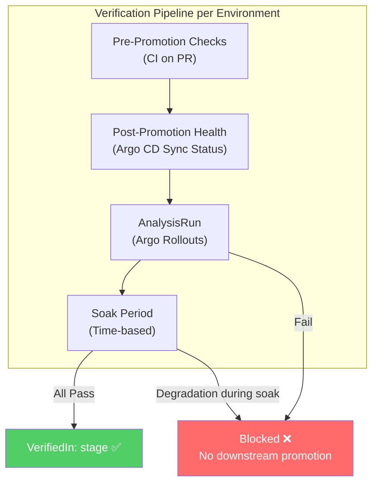

### 3.7 Rollback and Reliability

Kargo does not have a dedicated "rollback" primitive. Instead, rollback is achieved by **creating a new Promotion to a previously verified Freight**. This is architecturally consistent: every state change is a forward promotion through the same pipeline, ensuring auditability and avoiding out-of-band state mutations.

**Standard Rollback**: Identify the last known-good Freight from the Stage's Freight history (`Stage.Status.FreightHistory`). Create a new Promotion targeting that Freight. The promotion executes the same step sequence, updating every environment directory of the stage to reference the previous artifact versions. Only the affected stage is rolled back — downstream environments that haven't received the bad promotion are unaffected.

```bash
# Promote a specific known-good Freight to a Stage (rollback)
kargo promote --project <project> --freight <freight-id> --stage <stage>

# Or reference by alias
kargo promote --project <project> --freight-alias <alias> --stage <stage>
```

**Emergency Hotfix Path**: For critical failures where the standard pipeline is too slow:

1. Authorized operators can **manually approve** Freight for any Stage, bypassing upstream verification and soak requirements. This lets Freight skip intermediate environments entirely.
2. The hotfix Freight is promoted directly to the affected environment(s) using the same promotion steps, maintaining GitOps consistency.
3. This path is audited — manual approvals are recorded with timestamps and approver identity in the Freight status (`Freight.Status.ApprovedFor`).

```bash
# Manually approve Freight for a Stage (bypasses pipeline gates)
kargo approve --project <project> --freight <freight-id> --stage <stage>
```

**Via the Kargo UI**: click the three dots on the Freight in the timeline → "Manually Approve" → select the target Stage → "Approve". Then promote by clicking the truck icon on the Stage header → "Promote" → select the approved Freight → confirm.

Approval does not automatically create a Promotion — it only marks the Freight as eligible. A separate promotion (manual or auto) is still required.

**Reverification**: If a verification process fails or is inconclusive, it can be re-run on demand without re-promoting:

```bash
kargo verify stage <stage> --project <project>

# Abort a running verification
kargo verify stage <stage> --project <project> --abort
```

**Abort In-Flight Promotions**: Running Promotions can be aborted via the `kargo.akuity.io/abort` annotation. This immediately halts step execution, marks the Promotion as `Aborted`, and frees the Stage to accept the next queued Promotion (e.g., a rollback).

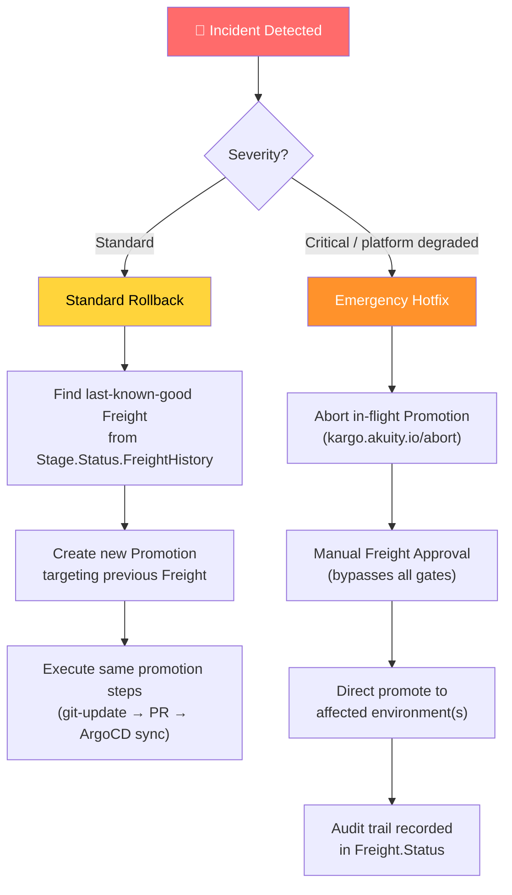

### 3.8 Observability and Auditability

Kargo provides built-in observability through its resource status model:

- **Freight Status**: Tracks which Stages a Freight is `CurrentlyIn`, `VerifiedIn`, and `ApprovedFor`—providing a real-time map of what version is deployed where and its verification state.
- **Promotion History**: Each Stage records its `CurrentPromotion` and `LastPromotion`, along with the full `FreightHistory` of recent deployments.
- **Step-level Telemetry**: Promotion status includes per-step execution metadata: start/finish times, retry counts, error messages, and state carried between reconciliation cycles.

Additional observability requirements:

- Grafana dashboards for environment transition latency, promotion success rates, and soak period compliance — see the [Kargo monitoring overview dashboard](https://grafana.stage.devshift.net/d/fg1ew0fv3xa0w7/kargo-monitoring-overview).
- Alerting on promotion failures, verification failures, and Freight stuck in an environment beyond expected soak windows.
- Integration with existing Konflux monitoring for correlated deployment-to-incident analysis.

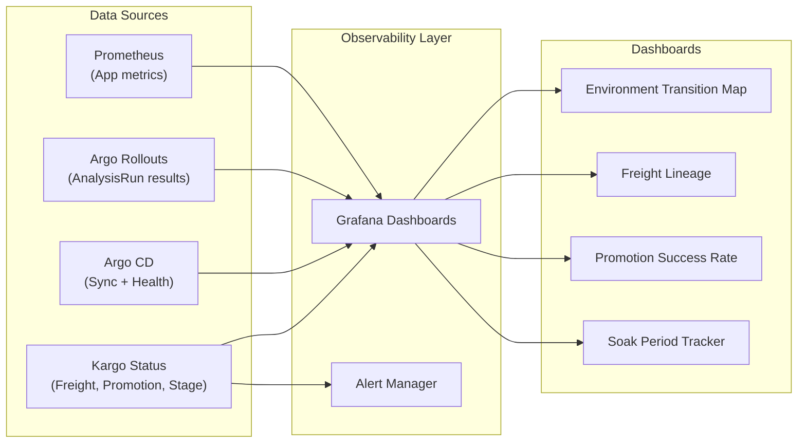

---

## 4. Component Interaction Model

This section maps how Kargo resources interact with external systems during the promotion lifecycle.

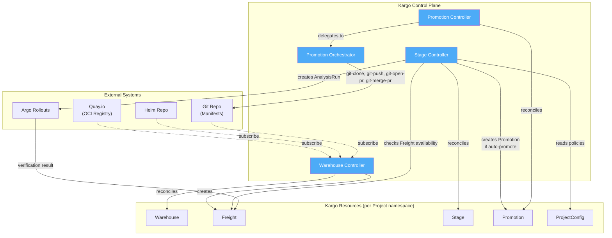

### Data Flow Summary

| Step | Source | Action | Target | Trigger |
|------|--------|--------|--------|---------|
| 1 | Quay / Helm / Git | Poll for new versions | Warehouse | Timer (5m interval) |
| 2 | Warehouse | Create immutable Freight | Freight | New artifact detected |
| 3 | Stage Controller | Check Freight availability | Freight Status | Freight creation event |
| 4 | Stage Controller | Create Promotion | Promotion | Auto-promote policy or manual |
| 5 | Promotion Controller | Execute promotion steps | Git Repo, Argo CD | Promotion created |
| 6 | Argo CD | Sync manifests to cluster | Kubernetes | Git repo updated |
| 7 | Stage Controller | Create AnalysisRun | Argo Rollouts | Promotion succeeded |
| 8 | Argo Rollouts | Report verification result | Freight Status | AnalysisRun complete |

---

## 5. Freight Lifecycle

Freight is the central artifact in the promotion pipeline. Its status transitions drive the entire environment progression.

### State Machine

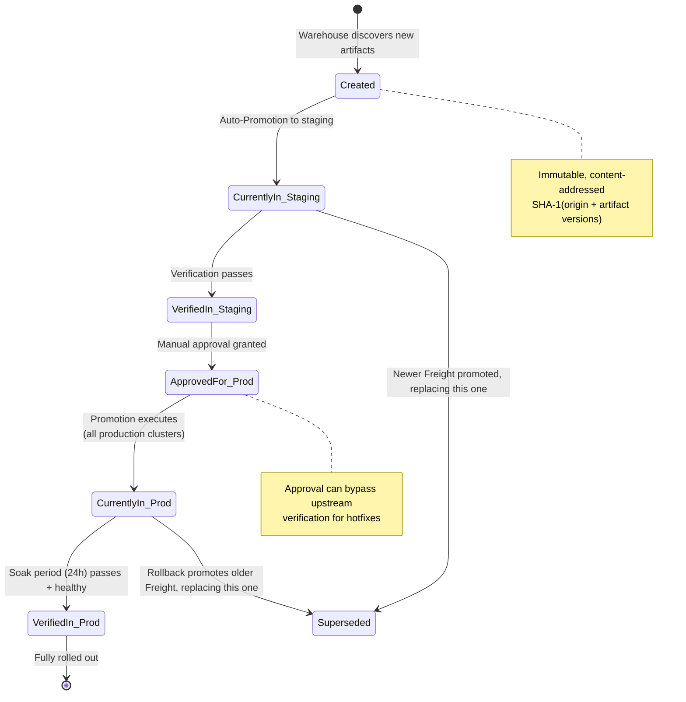

### Status Fields Reference

```
Freight.Status:
├── CurrentlyIn:           # Map of Stages where Freight is actively deployed
│   └── <stage-name>:
│       └── Since: <timestamp>     # Used for soak time calculation
│
├── VerifiedIn:            # Map of Stages where verification + soak passed
│   └── <stage-name>:
│       └── LongestCompletedSoak: <duration>
│
├── ApprovedFor:           # Map of Stages with manual approval
│   └── <stage-name>:
│       └── ApprovedAt: <timestamp>
│
└── Metadata:              # Arbitrary key-value data shared across steps/stages
```

---

## 6. Failure Mode Analysis

This section catalogs expected failure scenarios and the system's behavior in each case.

| Failure Mode | Impact | Detection | Automated Response | Human Action Required |
|-------------|--------|-----------|-------------------|----------------------|
| **Promotion step fails** (e.g., PR conflict) | Blocked promotion in one environment | Promotion phase → `Failed` | Retry on next reconciliation. Queue preserves ordering. | Investigate and resolve conflict; re-trigger Promotion |
| **Verification fails** (AnalysisRun) | Freight not marked `VerifiedIn`; downstream environments blocked | AnalysisRun phase → `Failed` | No downstream promotion occurs automatically | Review test results; fix component or adjust test thresholds |
| **Soak period degradation** | Freight fails stability check during soak | Metric thresholds breached | Freight remains `CurrentlyIn` but never reaches `VerifiedIn` | Initiate rollback via new Promotion to previous Freight |
| **Argo CD sync failure** | Cluster out of desired state | ArgoCD Application reports `OutOfSync` or `Degraded` | ArgoCD retries sync automatically | Check Argo CD Application health; resolve sync errors |
| **Warehouse polling failure** | New artifacts not discovered | Warehouse status shows error | Retries on next interval | Check registry credentials and connectivity |
| **Concurrent Freight arrival** | Multiple Freight compete for same Stage | Normal operation — queue serializes | Only one Promotion runs; next waits | None — by design |
| **Production environment failure** | Shared platform degraded | Environment health checks fail | Staging environments unaffected (still on previous version) | Use emergency hotfix path: manual approval + direct promote |
| **Controller crash / restart** | Temporary reconciliation pause | Kubernetes pod restart | Controller resumes from persisted state (Promotion.Status.State) | Monitor controller pod health |

### Shared Platform Degradation — Mitigation

The most critical failure mode is when a bad release reaches a production common cluster, degrading the shared platform other teams depend on:

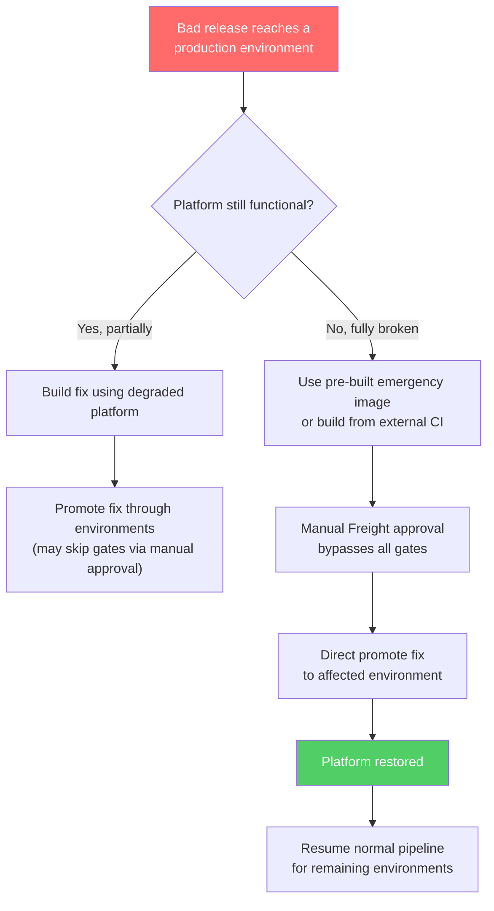

**Key design constraint**: production environments always receive releases last. Even if staging is updated, the production environment directories stay on the prior known-good version until the new release has passed verification and soak in staging.

---

## 7. Definitions

| Term | Definition |
|------|-----------|
| **Project** | The unit of tenancy in Kargo. A cluster-scoped resource associated with a Kubernetes namespace that contains all pipeline resources (Warehouses, Stages, Promotions, Freight) for a component or group of components. |
| **Warehouse** | A Kargo resource that monitors external artifact sources—OCI registries, Helm repositories, Git repositories—for new versions. Warehouses define subscriptions with discovery strategies (SemVer, Lexical, Digest) and produce Freight when new artifacts are detected. |
| **Freight** | An immutable, content-addressed "unit of release" produced by a Warehouse. Encapsulates the exact versions of container images, Helm charts, and Git commits that constitute a deployable change. Freight carries provenance metadata and tracks its verification and approval status across all Stages. |
| **Stage** | A promotion target representing a promotion stage (`staging` or `production`). Stages define what Freight they accept (from which Warehouses or upstream Stages), how to promote it (promotion step templates, which write every environment directory of the stage), and how to verify it (AnalysisRun templates). Stages form a DAG that models the promotion topology. |
| **Promotion** | A request to deploy a specific Freight to a specific Stage. Promotions execute an ordered sequence of steps (Git operations, Argo CD updates, Helm operations, etc.) and are serialized per Stage to prevent conflicts. |
| **PromotionTask** | A reusable, parameterized sequence of promotion steps defined as a Kargo CRD (`PromotionTask` or `ClusterPromotionTask`). Each component has its own PromotionTask per environment, defining how Kargo updates the Git repo for that component. The canonical directory layout keeps PromotionTask definitions simple — the target paths are computable from `{component}` and `{environment}`. |
| **Promotion Steps** | The ordered actions executed during a Promotion: cloning repos, updating manifests, opening PRs, waiting for merges, triggering Argo CD syncs, etc. Kargo provides 30+ built-in step types covering Git, Helm, Kustomize, Argo CD, HTTP, and more. |
| **Verification** | A post-promotion validation phase using Argo Rollouts AnalysisRuns. Verification determines whether Freight is marked as `VerifiedIn` a Stage, gating promotion to downstream environments. |
| **Soak Period** | A time-based stability requirement. Freight must remain deployed and healthy in a Stage for the configured duration before becoming eligible for promotion to the next environment. |
| **Environment** | A deployment target: `internal-staging`, `external-staging`, `internal-production`, or `external-production`. Each maps to exactly one common cluster and to exactly one Tier 2 directory in the component. The infra-common-deployments equivalent of a ring. |
| **Promotion stage** | A Kargo Stage (`staging` or `production`) that owns the environments of one stage. A single Promotion writes every environment directory of its stage, so the environments of a stage are promoted together. |
| **Environment directory** | The Tier 2 directory of a component for one environment: `components/{component}/{environment}/`. Holds the promoted image tags, Helm versions, upstream refs, environment-authored config, and `shared-resources-ref/`. ArgoCD points here. |
| **shared-resources** | The Tier 1 directory of a component (`components/{component}/shared-resources/`) holding resources shared by every environment. |
| **shared-resources-ref** | The snapshot of Tier 1 inside an environment directory (`components/{component}/{environment}/shared-resources-ref/`). Kargo copies it environment by environment within a single Promotion. |
| **Auto-Promotion** | A per-Stage policy that automatically creates Promotions when new eligible Freight becomes available, removing the need for manual promotion triggers in lower-risk environments. |
| **Progressive Delivery** | An architectural pattern characterized by the staged promotion of software changes through multiple environments, leveraging automated health signals and mandatory soak periods to detect and isolate failures early. |
